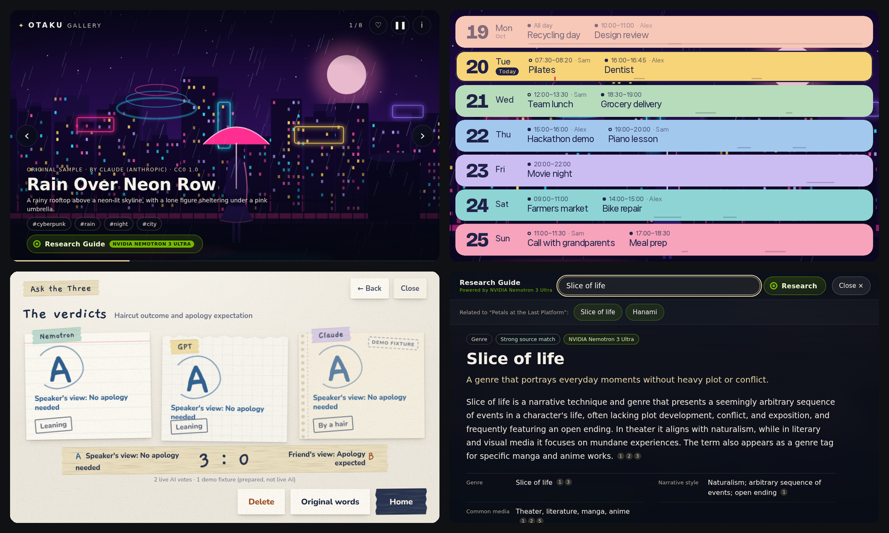
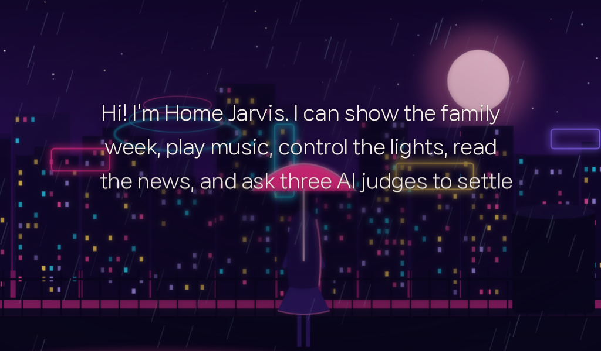
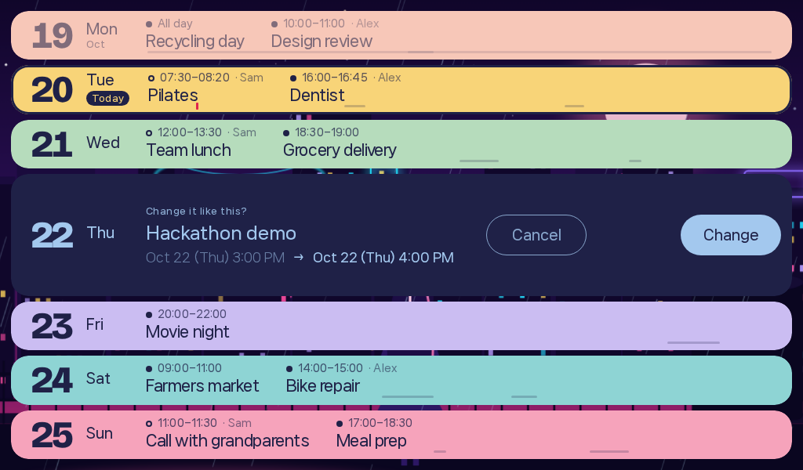
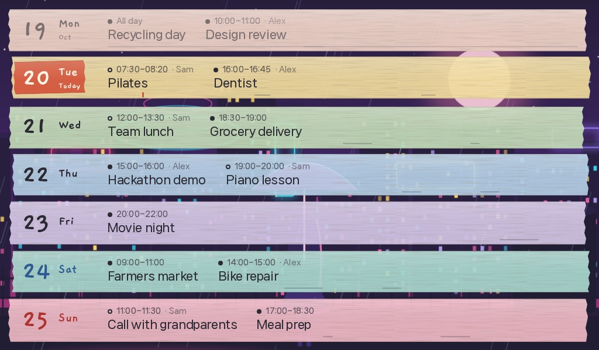
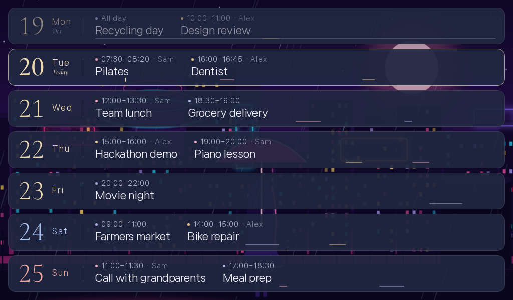
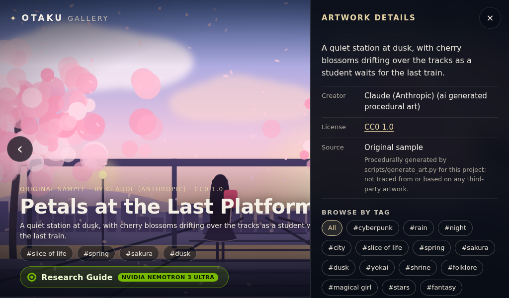
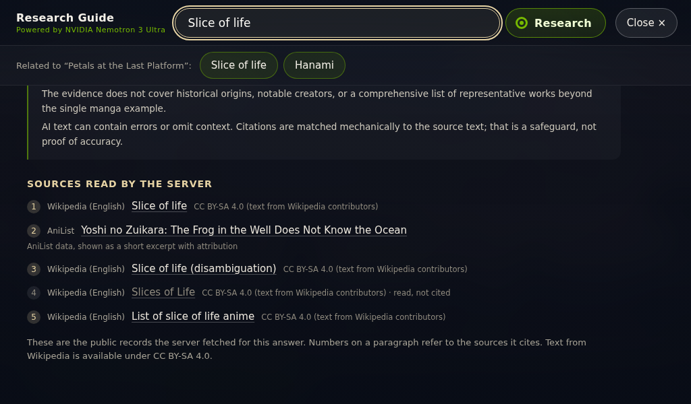
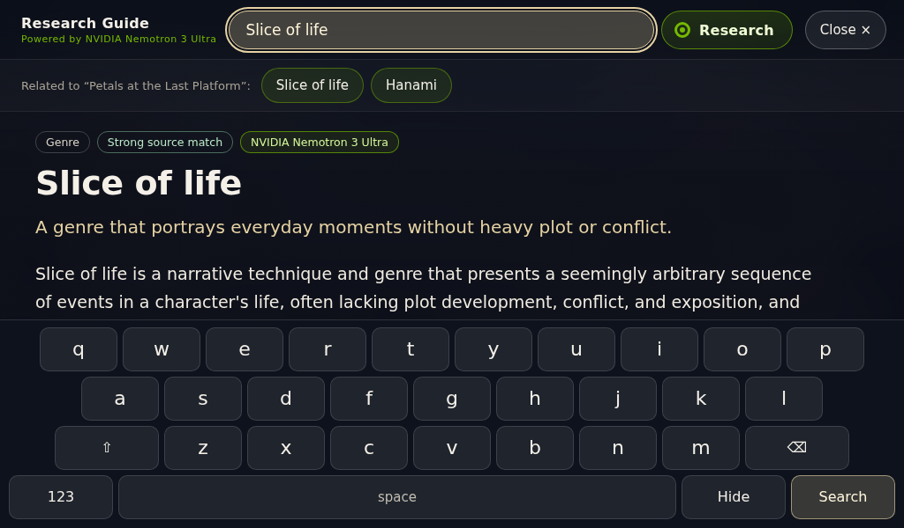
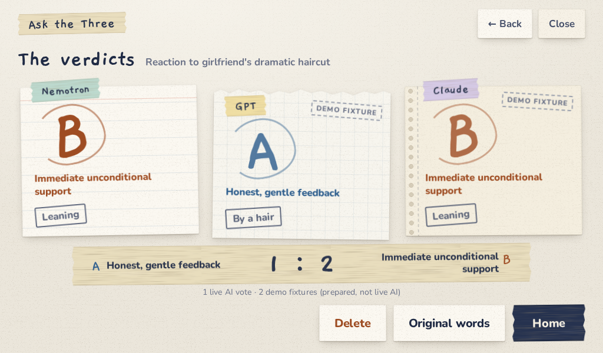

# Home Jarvis

**An evolving, real-world voice-and-touch AI home assistant powered by a Raspberry Pi, with specialized NVIDIA Nemotron capabilities running on Nebius Token Factory.**



<sub>Top: the kiosk gallery and the voice-opened week calendar (this repository, sample data). Bottom left: Ask the Three on the real Pi display, 2026-10-19 — Nemotron and GPT voted live, Claude was a labelled demo fixture. Bottom right: a live Nemotron Research Guide answer with numbered citations.</sub>

Home Jarvis lives on a wall in a real living room. Most of the time it is just a quiet picture frame. Say its name and the same picture is lit a little differently while it listens, thinks and answers; ask about the week and seven paper slats slide over the art; tap a painting to learn about it. When the moment passes, the screen goes back to being a gallery.

> *Jarvis is not an object on the screen. Jarvis is a property of the screen.* — and its design rule, *the gallery never moves; Jarvis moves.*

It is not a hackathon prototype. Home Jarvis has run in our home since before this hackathon and is still developed every week. For the **NVIDIA × Nebius Global AI Hackathon** we added two capabilities powered by **NVIDIA Nemotron 3 Ultra** on **Nebius Token Factory**, built English editions of them, and wired them into the real kiosk:

| | What it does | Where Nemotron works |
|---|---|---|
| **Ask the Three** | Describe a small everyday disagreement. A neutral summary is written, then three AI judges each pick a side on their own and the verdicts are revealed together. | Nemotron writes the neutral summary (organizer) **and** sits on the panel as a judge. |
| **OTAKU Gallery Research Guide** | Tap an artwork's topic tag (or type with the on-screen keyboard) and get a short English research page with numbered sources. | Nemotron writes the page from Wikipedia / AniList text the server fetched, citing only those records. |

This repository is the **official public showcase**: the real kiosk front-end, both Nemotron apps in full, and a one-command local setup. It is *not* the household's whole production system (see [what is and isn't here](#what-is-real-and-what-is-sample-data)).

> 🎬 **Demo video:** _link to be added_ · 🏷️ Built for the NVIDIA × Nebius Global AI Hackathon

---

## See it

<table>
<tr>
<td width="50%"><br><sub><b>Voice turn.</b> The picture stays; the reply appears as a caption in the image.</sub></td>
<td width="50%"><br><sub><b>Voice proposes, touch confirms.</b> "Move the demo an hour later" → tap <i>Change</i>.</sub></td>
</tr>
<tr>
<td><br><sub>Five week skins, switched by voice: Riso, Linen, Moonlight, <b>Tape</b>, Ribbon.</sub></td>
<td><br><sub><b>Moonlight</b> skin.</sub></td>
</tr>
<tr>
<td><br><sub>Artwork details and tags — the entry point to research.</sub></td>
<td><br><sub>Every claim is numbered against <b>sources the server actually read</b>.</sub></td>
</tr>
<tr>
<td><br><sub>The kiosk has no system keyboard, so the guide brings its own.</sub></td>
<td><br><sub>This repo with only a Nebius key: <b>1 live AI vote · 2 demo fixtures</b>, labelled on every card.</sub></td>
</tr>
</table>

More: [the judge's stage page](assets/screenshots/stage-desktop.png) · [real Pi captures](assets/screenshots/pi/) · [demo walkthrough](docs/demo-guide.md)

---

## Quick start

Requirements: **Python 3.11+** (tested 3.12.3 on Linux), network access to PyPI. Optional: Node.js (JavaScript tests), Playwright (browser checks).

```sh
git clone https://github.com/cpfree0411/home-jarvis-hackathon.git && cd home-jarvis-hackathon
./scripts/install.sh          # one .venv with both apps (editable) + test tools
./scripts/run.sh --demo       # no keys needed; nothing is sent to any AI provider
```

Open **http://127.0.0.1:8780/** — the stage page shows the 1024×600 kiosk next to a panel that plays the voice agent's part. Touch or click the kiosk exactly like the real screen.

| URL | What |
|---|---|
| `http://127.0.0.1:8780/` | Stage: kiosk + simulated voice-agent buttons + live/demo status |
| `http://127.0.0.1:8780/web/index.html?profile=otaku` | The kiosk alone. Set the browser window (or device emulation) to **1024×600** to see it as on the Pi. |
| `http://127.0.0.1:8780/ask-en/` | Ask the Three, full page |
| `http://127.0.0.1:8780/otaku-en/?kiosk=1` | OTAKU Gallery + Research Guide, full page |

Ports busy? `./scripts/run.sh --demo --port 18780 --ask-port 18794 --otaku-port 18805`.

### Live mode — real Nemotron on Nebius

```sh
cp .env.example .env && chmod 600 .env
# edit .env: NEBIUS_API_KEY=<your Nebius Token Factory key>
./scripts/run.sh               # reads ./.env; or --env-file /path/to/file
```

The startup banner and the stage page say **LIVE** or **DEMO**. With a key:

- **Ask the Three:** *New story → Try a sample → Use this story → Ask the three* (or type your own). Nemotron writes the summary and votes. GPT and Claude seats stay **labelled demo fixtures** unless you also add `OPENAI_API_KEY` + `ASK_THREE_OPENAI_MODEL` / `ANTHROPIC_API_KEY` — see [apps/ask-the-three/README.md](apps/ask-the-three/README.md).
- **Research Guide:** tap the artwork → a topic tag, or tap the search field and type on the on-screen keyboard.

A failed live call is shown as a failure. It is never silently replaced by a prepared answer.

| Mode | Ask the Three | Research Guide |
|---|---|---|
| **Demo** (`--demo` or no key) | Bundled sample stories only; prepared summary marked *not AI*; all three seats stamped **DEMO FIXTURE** | Shows **verbatim source excerpts** with a banner saying no AI summary was produced |
| **Live** (`NEBIUS_API_KEY`) | Nemotron organizer + Nemotron judge are live; other seats live only with their own keys | Nemotron writes a cited page; badge *NVIDIA Nemotron 3 Ultra* |

### Tests

```sh
./scripts/test.sh             # offline: no keys, no paid calls
```

Runs the showcase server/launcher tests, both apps' suites, the ported week-calendar JavaScript suite, a syntax check of every kiosk script and the public-safety audit. Browser and paid checks are separate and opt-in — see [docs/verification.md](docs/verification.md) for every command and the latest results.

---

## How Nemotron is used

Both apps call the OpenAI-compatible **Chat Completions** API of **Nebius Token Factory** with model **`nvidia/Nemotron-3-Ultra-550b-a55b`**, `temperature: 0`, `chat_template_kwargs.enable_thinking: false`, a **strict JSON schema** response format, and no tools. Both reject a response whose `model` differs from the one requested.

```
                ┌──────────────────────── Ask the Three (FastAPI) ─────────────────────────┐
 story text ──► │ organizer: Nemotron → neutral A/B summary ─► you approve ─► 3 seats in   │
                │ parallel: Nemotron (live) · GPT · Claude (live with keys, else fixture)  │──► sealed until all
                └──────────────────────────────────────────────────────────────────────────┘    finish, then reveal
                ┌──────────────────── OTAKU Research Guide (stdlib) ───────────────────────┐
 topic / query ►│ server fetches Wikipedia + AniList text ─► Nemotron writes a page citing │──► page + numbered
                │ record ids only ─► server maps ids to URLs, checks names/numbers in text │    sources
                └──────────────────────────────────────────────────────────────────────────┘
```

Read the code: [`apps/ask-the-three/ask_three_en/providers.py` → `nebius_complete`](apps/ask-the-three/ask_three_en/providers.py), [`ai.py` → `organize_story`, `run_member`](apps/ask-the-three/ask_three_en/ai.py), [`domain.py` → `organized`, `panel_result`](apps/ask-the-three/ask_three_en/domain.py); [`apps/otaku-gallery/otaku_gallery/nebius.py` → `NebiusWriter.write`](apps/otaku-gallery/otaku_gallery/nebius.py), [`research.py` → `ResearchManager._run`, `build_page`](apps/otaku-gallery/otaku_gallery/research.py). Details, request bodies, parsing and failure handling: **[docs/nemotron-integration.md](docs/nemotron-integration.md)**.

Measured on 2026-10-20 from this repository: Ask the Three's Nemotron organizer **2.0–2.6 s** and the judge panel **2.1 s** end-to-end through the kiosk proxy; a single judge call **1.67 s** (475 tokens); a Research Guide page **2.84 s** (1,873 tokens). All results: [docs/verification.md](docs/verification.md). Feedback on the platform: [docs/nebius-feedback.md](docs/nebius-feedback.md).

---

## Architecture

```
        Living room                                        Home server
 ┌──────────────────────────────────┐            ┌──────────────────────────────────┐
 │ Raspberry Pi 5                   │            │ Ask the Three EN   :8794 ────────┼──► Nebius Token Factory
 │  1024×600 touch display          │  SSH-      │ OTAKU Gallery EN   :8805 ────────┼──►   (Nemotron 3 Ultra)
 │  ReSpeaker XVF3800 mic array     │  forwarded │ Calendar / gallery curation,     │──► Wikipedia, AniList
 │  Cage + Chromium kiosk ◄─────────┼─ loopback ─┤ Home Assistant, Ask (Korean) ... │
 │  visual server (SSE, proxy) ─────┼──────────► └──────────────────────────────────┘
 │  Gemini Live voice agent + wake  │
 └──────────────────────────────────┘
                     This repository reproduces the dashed-in part on one machine:
   kiosk/web (real renderer, week calendar, Ask/OTAKU hosts) + kiosk/showcase.py (same HTTP/SSE contract,
   sample data, simulated voice events, /ask-en/ and /otaku-en/ proxy incl. WebSocket) + apps/*
```

Full write-up: [docs/architecture.md](docs/architecture.md) · hardware: [docs/hardware.md](docs/hardware.md).

## What is real and what is sample data

| Part | In this repo |
|---|---|
| Kiosk renderer, state pill, caption reveal, wake ripple, week calendar + 5 skins, Ask overlay, OTAKU host | **Real production code** from the Pi's deployed revision; strings translated to English, household identifiers replaced |
| Ask the Three (English) and OTAKU Gallery (English) | **Complete apps**, same code that runs behind the Pi in English mode |
| Nemotron calls | **Real**, with your key |
| Calendar events, people ("Alex", "Sam") | **Fictional**, generated around today's date, changes kept in memory |
| Voice agent | **Simulated** — buttons replay the SSE messages the Gemini Live agent sends; no speech is processed by them |
| Gallery art | **Original CC0 procedural SVGs** (not third-party anime art) |
| Family photos, news, music, weather, smart-home control, notes | **Not included** — they depend on private accounts and data |

Why and how we drew this line: [docs/privacy-and-scope.md](docs/privacy-and-scope.md).

## Hardware (production)

Raspberry Pi 5 · 1024×600 HDMI touch display · ReSpeaker XVF3800 4-mic array (input and AUX speaker output) · a home server for curation, apps and Home Assistant. No Pi is needed to run this repository. [docs/hardware.md](docs/hardware.md)

## Built during the hackathon

Home Jarvis predates the hackathon (the renderer's history starts 2026-09-05; the week calendar shipped 2026-10-15). Everything Nemotron-related dates from **2026-10-19** onward: the Nemotron judge seat, the English Ask the Three, the English OTAKU Gallery and its Nemotron Research Guide, the touch keyboard port, the private English mode on the real Pi, and this public package. The complete, dated list with what is *not* new: **[docs/hackathon-updates.md](docs/hackathon-updates.md)**.

## Still evolving

Home Jarvis is used every day and changes every week — recent work includes ambient sticky notes, a touch music explorer and personalised gallery curation (not part of this showcase). The Nemotron judge seat is also live in the household's own Korean Ask the Three.

## Repository layout

```
kiosk/web/          real kiosk front-end (renderer, week calendar, overlays) + stage page
kiosk/showcase.py   showcase server: sample APIs, SSE, simulated voice, app proxy
kiosk/tests/        week-calendar JavaScript suite (ported, fictional data)
apps/ask-the-three/ Ask the Three, English edition (FastAPI)      — own README, tests, docs
apps/otaku-gallery/ OTAKU Gallery + Research Guide (stdlib only)  — own README, tests, docs
scripts/            install / run / test, browser check, screenshots, public audit
tests/              showcase and launcher tests
docs/               architecture, Nemotron, hardware, hackathon updates, feedback, demo, privacy, verification
assets/screenshots/ README images (synthetic or sample content only)
```

## License

[MIT](LICENSE) for the code in this repository. Bundled fonts are SIL OFL 1.1, the vendored thinking-orbs engine is MIT, the gallery art is CC0 1.0, and bundled Wikipedia excerpts are CC BY-SA 4.0 — see [NOTICE](NOTICE). Provider and model names identify integrations and imply no endorsement.
