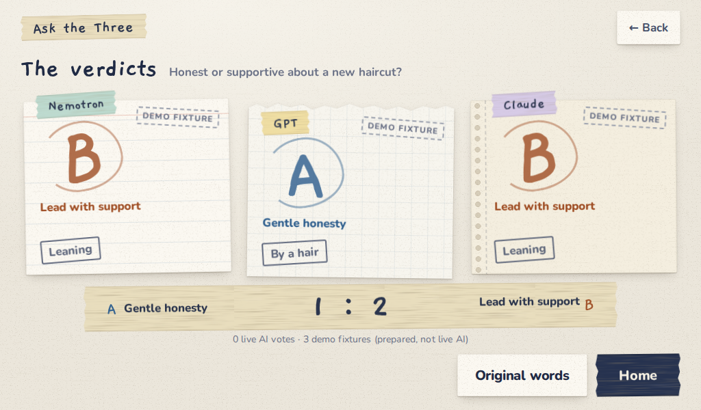

# Ask the Three — English edition

One everyday disagreement, three independent judges, revealed together. Tell
the story, review a neutral A/B summary, then open three sealed paper slips.
Built for a 1024×600 touch display with local fonts, ruled paper, sticky notes,
muted tape, and reduced-motion support. It also runs in a desktop browser.



**NVIDIA Nemotron 3 Ultra 550B runs through Nebius Token Factory.** The neutral
organizer and Nemotron seat use `nvidia/Nemotron-3-Ultra-550b-a55b` by default.
GPT and Claude are independent, optional seats. Without their credentials, each
is visibly labelled **demo fixture**, including in saved stories. A failed live
seat stays failed; it never silently becomes a fixture. Fixture votes appear in
the displayed tally, while `live_votes` separately counts real completed votes.

## Run locally

Requires Python 3.11+ with `venv`, pip, and network access for installation.
Tested on Linux with Python 3.12. From this checkout:

```sh
./scripts/install.sh
.venv/bin/ask-three-en check
.venv/bin/ask-three-en serve
```

Open **http://127.0.0.1:8794/** on the machine running the server. No keys are
needed for **New story → Try a sample → Use this story → Ask the three**.
This mode uses prepared summaries and three clearly marked fixture answers;
it does not claim to run live models. Custom typed or spoken stories require
the live Nebius organizer. The app imports no private checkout or credentials.

The install script creates `.venv` and installs the app plus test dependencies,
using the tested versions in `constraints.txt`. It installs no service. A manual
equivalent is `python3 -m venv .venv` then
`.venv/bin/python -m pip install -c constraints.txt '.[dev]'`.

## Real judges

```sh
cp .env.example .env
chmod 600 .env
# Edit .env locally: set NEBIUS_API_KEY to your own key.
.venv/bin/ask-three-en check --env-file .env
.venv/bin/ask-three-en serve --env-file .env
```

Create your own key at [Nebius Token Factory](https://tokenfactory.nebius.com/).
Keys stay server-side and `.env` is ignored by Git. Existing environment values
take precedence over the optional env file; there is no implicit `.env` loading.
The Nebius endpoint defaults to `https://api.tokenfactory.nebius.com/v1`.
Nemotron uses strict JSON, temperature 0, thinking off, a 1,200-token completion
limit, and exact returned-model validation. Parse failures get one repair call;
provider failures become bounded error categories. The organizer is a separate
call before approval. A normal story costs one organizer call plus one call
per live judge, with at most one schema-repair call per role.

| Seat | Configuration | Without configuration |
| --- | --- | --- |
| Nemotron | `NEBIUS_API_KEY` | Labelled demo fixture |
| GPT | `OPENAI_API_KEY` **and** `ASK_THREE_OPENAI_MODEL` | Labelled demo fixture |
| Claude | `ANTHROPIC_API_KEY`; optionally `ASK_THREE_ANTHROPIC_MODEL` | Labelled demo fixture |

For a fully live three-judge demonstration, configure all three seats and check
that `/health` reports three `live: true` entries. Then use a sample or your own
fictional story. `python scripts/smoke_e2e.py http://127.0.0.1:8794/ --require-live`
performs the complete paid workflow and fails unless every live judge completes.
`check` reports configuration only; `/health` is readiness, not a provider probe.

Already authenticated local CLIs are an opt-in alternative:
`ASK_THREE_SEAT_GPT=codex-cli` with `ASK_THREE_CODEX_MODEL`, and
`ASK_THREE_SEAT_CLAUDE=claude-cli`. The respective executable must be on the
service's PATH. `ASK_THREE_CODEX_BIN` / `ASK_THREE_CLAUDE_BIN` can select it.
`ASK_THREE_CODEX_AUTH` / `ASK_THREE_CLAUDE_CREDENTIALS` can point to an
operator-owned login file; otherwise the CLI's usual user login is referenced
by a symlink in this app's isolated role state. Login files are never copied or
shipped. CLI flags are version sensitive; verify under your actual service
account. API seats need no CLI installation. Details: [integration contract](docs/INTEGRATION.md).

## English speech

Set `GEMINI_API_KEY` to enable **Start talking**. The browser streams PCM16 mono
16 kHz over the app WebSocket; the server connects to
[`gemini-3.5-transcribe-live`](https://ai.google.dev/gemini-api/docs/live-api/live-transcribe).
`ASK_THREE_STT_LANGUAGE=en-US` is the default; `auto` enables detection.
The app stores transcript text, never raw microphone audio. It provides speech
**input**, not spoken verdicts. Browser microphone access needs localhost or
HTTPS, permission, and a working input device. Remote plain HTTP cannot provide
the same browser microphone guarantee.

For an explicit provider test using your own short synthetic recording, install
ffmpeg and run `.venv/bin/ask-three-en smoke-stt synthetic.wav --env-file .env`.
This makes a live Google call. See [verification](docs/VERIFICATION.md) for the
previously observed 7.54-second English and auto-detection results and their limits.

## Verify

```sh
./scripts/test.sh
# Optional browser suite: install Playwright and its Chromium binary.
.venv/bin/python -m pip install -c constraints.txt '.[browser]'
.venv/bin/python -m playwright install chromium
.venv/bin/python scripts/browser_test.py /tmp/ask-three-browser-shots
```

Minimal Linux images may also need Playwright's OS dependencies; see the
[official installation instructions](https://playwright.dev/python/docs/browsers).
The browser harness uses only synthetic stories, gated fixture judges, a scripted
transcriber and Chromium's fake microphone. It checks 1024×600 screens, the
unchanged waiting UI, English text, fonts, touch targets, overflow, and errors.
It does **not** prove live speech recognition. Unit/API/CLI tests make no paid calls.
The public audit checks the Git candidate files for private paths, secret-like
values, local addresses, unwanted files, image metadata and bundled font notices.

Optional paid Nemotron probe: `.venv/bin/ask-three-en smoke-nemotron --env-file .env --yes`.
It checks model availability and performs one judge call on a fictional sample.

## State and deployment

Default bind: `127.0.0.1:8794`. Default state:
`$XDG_STATE_HOME/ask-three-en` or `~/.local/state/ask-three-en`; never another app's
database. Override with `ASK_THREE_STATE`, and optionally `ASK_THREE_DB`.
Run exactly one application process per database. Stories and transcripts persist
in SQLite; deletion hides a story from the archive and is **not** secure erasure.

This is a local household/demo application, without user accounts or public
multi-tenant authentication. An authenticated gateway is required for Internet
exposure. Host, client and Origin allowlists default to loopback. Reverse proxies
must preserve and explicitly allow the intended Host/Origin, strip the path prefix,
and forward WebSocket upgrades. HTTP forwarded headers are not trusted.

`ASK_THREE_MAX_INFLIGHT=2` limits concurrent story work;
`ASK_THREE_DAILY_LIVE_LIMIT=60` limits approved live panels per UTC day. These
are local safeguards, not billing caps: organizer and speech calls are separate.
Use provider account budgets for spending limits.

The [Home Pi integration contract](docs/INTEGRATION.md) and
[example user service](deploy/ask-three-en.service.example) describe the stable
root index, `/health`, server CLI, iframe and optional microphone lease settings.
Deployment is deliberately separate from source installation.

## License and attribution

Application and synthetic screenshots: [MIT](LICENSE). Bundled Gaegu and Nunito
font subsets: **SIL OFL 1.1**, with full licenses in `ask_three_en/web/fonts/`.
Read [NOTICE](NOTICE) and the [license audit](docs/LICENSE_AUDIT.md) before
redistribution. No model weights, provider accounts, private data or keys are
included. [Verification and screenshot provenance](docs/VERIFICATION.md).
