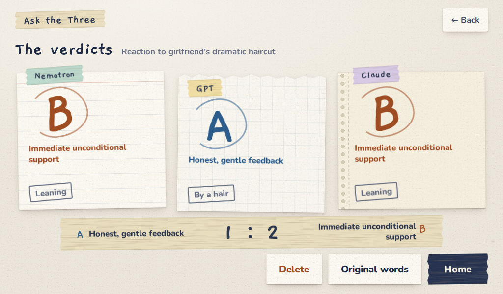

# Verification — English standalone edition

This task continues the previous implementation rather than replacing it. The
predecessor execution ended **BLOCKED by its session limit** before documentation,
publication review and an initial commit. That historical result is retained;
the finishing execution has its own completion claim and validation.

## Finishing execution checks

On 2026-10-19, Linux / Python 3.12:

- All 31 Python tests pass, including full real-process CLI/HTTP sample E2E,
  review, three votes, archive, delete, reveal embargo, restart recovery,
  request security, provider protocol, English/public-material checks and
  Google WebSocket protocol/early-close/PCM validation.
- Python source compiles and JavaScript passes `node --check`.
- A clean copy without a venv installs through `scripts/install.sh`; the full
  suite passes there. A built wheel installed outside the source includes the
  HTML/JS/CSS, both fonts, both complete OFL notices, LICENSE and NOTICE.
- A temporary systemd user service launches that installed wheel from outside
  the checkout with an empty environment except PATH and explicit isolated
  state/port. Health, English root index and a full three-fixture sample workflow
  pass. It is stopped after the check; this is not a Pi deployment claim.
- Chromium 1024×600 fixture suite: 27 screens; zero Korean characters,
  horizontal overflow, undersized touch targets or console errors; both fonts
  loaded. The waiting DOM stays identical after one and two completed judges.
  Recording and error screens use a scripted transcriber and fake microphone.
- Read-only browser inspection of the predecessor's real synthetic panel:
  six screens, zero Korean characters, horizontal overflow, undersized targets
  or console errors. This reopens saved results and makes no provider calls.
- Public candidate files pass `scripts/public_audit.py`. Fonts have full OFL
  notices; dependency license metadata and screenshot metadata are audited.

The HTTP test client reports one upstream Starlette deprecation warning for
httpx; it is not a test failure. Deployment on a Pi and a physical microphone
test are owned by the separate integrator and are not claimed here.

Machine-readable evidence:

- [Fixture browser checks](verification/browser-fixture.json)
- [Real saved-result browser checks](verification/browser-live-readonly.json)
- [Public file audit and font hashes](verification/public-audit.json)
- [Installed dependency license inventory](verification/dependency-licenses.json)
- [Service-context preflight](verification/service-preflight.json)
- [Tests and syntax checks](verification/tests.json)
- [Clean installation and wheel contents](verification/setup.json)
- [Recovered predecessor live checks](verification/predecessor-live-evidence.json)

## Observed real model calls from the predecessor

These results were recovered from its actual command output, synthetic story
rows opened read-only, and service journal. They are not freshly repeated live
checks. No private paths, login data or audio are copied into this repository.

The standalone Nebius smoke used exactly
`nvidia/Nemotron-3-Ultra-550b-a55b`, confirmed the served model, and passed:
362 prompt + 113 completion tokens, 1.686 seconds, estimated USD 0.000701 at
the prices returned in that run. Prices are historical evidence, not a current
quote. The English response chose B / LEAN.

The later complete fictional haircut story used the same Nemotron model as
organizer and first judge, Codex CLI `gpt-6.1-sol` for GPT, and Claude CLI
`claude-sonnet-5-5` for Claude. All three were real, independently completed
seats. The final saved haircut panel chose Nemotron B / LEAN, GPT A / CLOSE,
Claude B / LEAN: **A 1 : B 2, three live votes**. One earlier reported E2E
also completed three real seats, with zero embargo leaks and zero Korean text.
The recovered service journal contains six Nebius requests (organizer and judge
pairs across three synthetic attempts), totaling 2,543 prompt and 1,205
completion tokens. The separate single-judge smoke adds one Nebius request.
One first attempt was interrupted while a CLI was running; it is not counted
as a successful complete panel. The finishing worker made **zero additional
paid calls**.

## Observed English audio

The predecessor generated a **7.54-second synthetic ffmpeg voice clip** and
streamed it through Google's `gemini-3.5-transcribe-live`:

| Language setting | Observed result | Interim events | Final transcript length |
| --- | --- | --- | --- |
| `en-US` | PASS | 15 | 142 characters |
| `auto` | PASS | 14 | 142 characters |

The English transcript accurately described the synthetic haircut question.
This is evidence of server-to-Google English speech input, not a physical
microphone test, spoken verdict output, or Pi gallery acceptance. The finishing
worker tests the wire protocol and scripted browser path without another
Google call. It additionally bounds idle streams and handles premature upstream
closure, covered by tests. The prior live speech result predates that small
failure-handling change; it is not presented as a fresh paid run of this commit.

## Curated screenshot provenance

All images are 1024×600 Chromium captures, created from this repository's
bundled fictional haircut example and original paper CSS:

| File in `docs/screenshots/` | Content |
| --- | --- |
| `home-demo.png` | Three explicitly marked fixture seats |
| `review-demo.png` | Prepared sample summary labelled as not AI |
| `waiting-demo.png` | Three sealed slips before reveal |
| `verdict-demo.png` | Three prepared answers, stamped demo fixtures |
| `detail-demo.png` | Prepared Nemotron-seat example with fixture disclosure |
| `verdict-live-synthetic.png` | Read-only reopened result of the predecessor's real three-seat synthetic run |

The live screenshot is not a fixture or edited to suggest model execution.
Only the story is synthetic. No external browser chrome, personal accounts,
secret values, private hostnames or recordings appear. PNG metadata was
checked. All screenshots can be reused under the application's MIT license.

## Reproduction boundary

`scripts/test.sh` and `scripts/browser_test.py` run locally without keys.
For real providers, configure your own credentials and models per README,
inspect `/health`, then explicitly run the paid smoke. Provider availability,
quotas and CLI versions may change. `constraints.txt` records the tested Linux
dependency versions; other OS/Python versions have not been verified.
