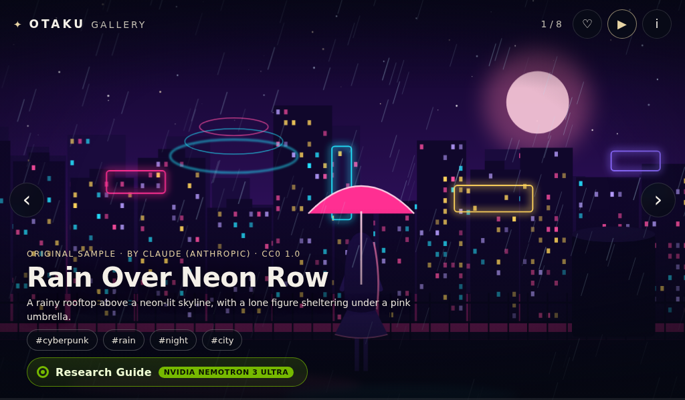

# OTAKU Gallery · English

An ambient, full-screen gallery with eight original anime-inspired SVG scenes and a cited Research Guide written by **NVIDIA Nemotron 3 Ultra through Nebius Token Factory**. Designed for a **1024 × 600 kiosk**, with desktop and phone layouts, crossfades, a slow camera drift, tag filters and browser-local favorites.



The artwork is original procedural demo art, created with Claude assistance and dedicated under **CC0 1.0**. It is not artwork from the anime or manga suggested as reading topics. Code is MIT; bundled Wikipedia excerpts retain CC BY-SA 4.0. See [LICENSE](LICENSE), [NOTICE](NOTICE), and [license texts](LICENSES).

## Install and run

Requires Python **3.10+**. The application has **no runtime dependencies**, Node build, private service, or external font dependency. These commands work on Linux/macOS; on Windows use `py -m venv .venv` and `.venv\Scripts\Activate.ps1` to activate.

```sh
python3 -m venv .venv
. .venv/bin/activate
python -m pip install .
# Optional: copy .env.example to .env and edit it locally.
otaku-gallery
```

Open **http://127.0.0.1:8805/**. The equivalent checkout command is `python -m otaku_gallery`. Run from the checkout to load its `.env`, or run the installed command from any directory with a local `.env`. Process environment variables take precedence over the file. Wheel installation includes the UI, art, manifest, snapshots, and notices.

The server binds **localhost only** by default. **8805** is the demo/integration port. If it is occupied, choose a free port with `OTAKU_PORT=18805 otaku-gallery`. Bind failure exits with an English error; it never stops another listener. No service is installed automatically. Stop a foreground instance with Ctrl+C.

## Enable the real writer

Create a Nebius Token Factory API key, put it in your local `.env` as `NEBIUS_API_KEY=...`, and restart. Never commit that file. The fixed provider/model pair is:

- Provider: Nebius Token Factory, `https://api.tokenfactory.us-central1.nebius.com/v1/chat/completions`
- Model: `nvidia/Nemotron-3-Ultra-550b-a55b`

This endpoint and model are listed in the [official Nebius cookbook](https://github.com/nebius/token-factory-cookbook/blob/main/models/nemotron/nemotron3-ultra-550b-a55b.md). No model substitution occurs; a mismatched response is rejected. Requests use a strict JSON schema, no model tools, temperature zero, thinking disabled, and at most 4,000 output tokens. The server bounds evidence length, HTTP response size, elapsed time, concurrency, and research frequency.

The gallery works without a key. Research then shows clearly labeled, attributed **source excerpts**, rather than pretending to be an AI answer. Provider failures, malformed output, timeouts, and truncated responses use the same fallback when sources exist. An unknown subject with no evidence returns “No matching sources found.” No private agent service is required.

## Explore

- **← / →**: previous / next artwork; swipe horizontally on touch screens.
- **Space**: pause / resume; **F**: favorite; **I**: artwork details and filters.
- **R**: Research Guide; **Esc**: close details or research.
- Click a suggested theme or search an **artist, character, work, game, or genre**. Try `Hayao Miyazaki`, `Motoko Kusanagi`, `Ghost in the Shell`, or `Cyberpunk`.
- Tab/Shift+Tab navigate controls. Research traps focus while open and restores it on close.
- Touch screens: tapping the Research search field opens an on-screen QWERTY keyboard (Shift, 123 symbols, Backspace, space, Hide, Search). It appears with `?kiosk=1`, `?keyboard=1`, or a coarse pointer at least 900 px wide; `?keyboard=0` turns the automatic coarse-pointer case off. Search or Hide dismisses it, and a hardware keyboard keeps typing into the field.

URL options: `?autoplay=0` starts paused; `?interval=20` sets seconds per image (6–120); `?kiosk=1` displays reference addresses in a toast instead of opening a new tab; `?bg=host` enables a transparent host frame.

Favorites stay in this browser's localStorage. Research queries go to the server and public reference sites. With a configured key, the query and bounded source excerpts also go to Nebius. No artwork, favorites, or API key is sent to the model or exposed to the browser. The server does not log prompts, response bodies, or keys; model proof records only usage and technical validation metadata.

## Sources and limitations

The server fetches **English Wikipedia** and **AniList** public APIs, then passes plain text evidence to Nemotron. The model cannot choose a URL, execute tools, or inspect an artwork. Citation URLs come from fetched records. Names and numbers are matched mechanically to cited text; unmatched passages remain visible with a caution and reduced confidence. This heuristic does **not** prove semantic accuracy. Follow the citations and check the original wording.

`auto` mode prefers live sources and substitutes an attributed Wikipedia snapshot when Wikipedia is unavailable and a known bundled topic matches. Snapshot badges disclose this. `live` disables snapshots; `fixture` uses only bundled snapshots but still calls Nebius when a key exists. Bundled coverage is limited to the gallery themes, so artist/character searches normally need live sources. AniList is not bundled. Adult-topic filters and spoiler stripping are best-effort; upstream excerpts may still mention mature themes.

| Variable | Default | Purpose |
| --- | --- | --- |
| `OTAKU_HOST` | `127.0.0.1` | Bind address |
| `OTAKU_PORT` | `8805` | Listen port |
| `OTAKU_RESEARCH` | `1` | Enable research API |
| `OTAKU_EVIDENCE_MODE` | `auto` | `auto`, `live`, or `fixture` |
| `OTAKU_RATE_MAX_RUNS` | `10` | New searches per 10 minutes, plus a 2-second minimum interval |
| `OTAKU_CACHE_TTL` | `600` | In-memory result cache seconds; `0` disables it |
| `OTAKU_LOCAL_MANIFEST` | `media/gallery.json` in working directory | Optional local art |
| `OTAKU_ALLOWED_ORIGINS` | empty | Explicit additional origins allowed to post |
| `OTAKU_FRAME_ANCESTORS` | `'self'` | CSP embedding allowlist |
| `OTAKU_LOG_LEVEL` | `WARNING` in example | Standard Python log level |

Research sessions and cache are memory-only and expire; the newest search supersedes an older running one across all clients. This is a single-user kiosk/demo. The HTTP server has no authentication. Keep it on loopback or place it behind an authenticated reverse proxy before enabling remote access or spending shared API credit.

## Integration contract

Integration is independent of any host portal. This repository changes no host service. Integrators should target `http://127.0.0.1:8805/health` and embed the gallery URL, optionally `/?bg=host&kiosk=1`. To use a same-origin path prefix, strip the prefix at the reverse proxy (for example `/gallery/` → `/`), preserve the public Host header, and proxy **all** static and API requests. Asset/API URLs are relative; the prefix URL must end with `/`. For cross-origin framing explicitly set `OTAKU_FRAME_ANCESTORS` to the trusted portal origin. Do not trust arbitrary forwarded headers.

| Endpoint | Result |
| --- | --- |
| `GET /health` | Non-secret liveness, version, artwork count, model and capability flags |
| `GET /api/config` | Browser capability configuration |
| `GET /api/gallery` | Validated public artwork metadata |
| `POST /api/research` | JSON `{"query":"Cyberpunk"}` or `{"item_id":"neon-rooftop-rain","topic_id":"cyberpunk"}` |
| `GET /api/research/<id>` | Poll until `done`, `cancelled`, or `failed`; terminal `page.status` describes the result |
| `POST /api/research/<id>/cancel` | JSON `{}` cancels work |

POSTs require `Content-Type: application/json` and a same-origin or explicitly allowed Origin. A stable `request_id` makes a submission idempotent; `refresh: true` bypasses the cache. HTTP errors return `{"ok":false,"error":{"code":"...","message":"English sentence."}}`. Rate limiting is a terminal research page with `retry_after` seconds. Only manifest-listed art and allowlisted static filenames are served.

## Local art and development

Copy the shape of `data/gallery.json` into the ignored `media/gallery.json`, use distinct IDs and relative image filenames, and include creator, license, source and alt text. Put only artwork you may redistribute there; local additions are intentionally excluded from Git. Original samples can be regenerated with `python scripts/generate_art.py`. Wikipedia snapshots can be refreshed with `python scripts/refresh_snapshots.py`; update NOTICE revision links afterward.

```sh
python -m unittest discover -v
python scripts/audit_repo.py --history
python -m pip install '.[test]' build
python -m playwright install chromium
python scripts/ui_smoke.py --summary docs/validation/browser-offline.json
python scripts/ui_smoke.py --missing-key --summary docs/validation/browser-fallback.json
python scripts/ui_contract.py
python -m build
python scripts/install_smoke.py
```

Browser smoke defaults to a clearly labeled offline writer stub and uses ephemeral localhost ports, so it spends no API credit. Screenshots cover kiosk, desktop, phone, artwork details, research and sources. The separate opt-in `scripts/model_smoke.py` makes one bounded real request with a public fixture and saves only provider/model, usage, cost estimate, timings and validation flags. Its ledger reserves a conservative maximum before each call and refuses reservations above $0.25 total. Load `NEBIUS_API_KEY` into the process before using it. Neither validation command logs prompts or keys.

Release evidence and known limits are in [docs/VALIDATION.md](docs/VALIDATION.md). No remote or public publication is configured by the install commands.
